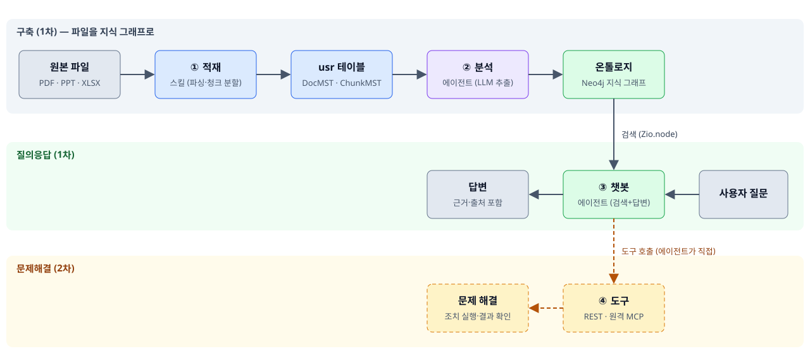

# HELPDESK 작업계획서

- 작성일: 2026-10-02
- 상태: **초안 (사용자 확정 전)**
- 목표·KPI: [KPI.md](KPI.md)
- 근거 문서: `.sdk_manual/` 02·03·05·06·07·09·12·14, `02_METHODOLOGY/` 01·02·03·06, `01_NWSOFT_Table/`

---

## 1. 무엇을 왜 만드는가

오프라인에 흩어진 도움말 파일(PDF · PPT · 엑셀)을 **지식 그래프(온톨로지)** 로 바꾸고, 그 그래프를 근거로 사용자 질문에 답하는 **헬프데스크 챗봇**을 만든다. 2차에서는 에이전트가 **도구를 직접 호출**해 문제를 해결하게 한다.



## 2. 범위

| 구분 | 포함 | 비고 |
|---|---|---|
| **1차** | ① 적재 · ② 분석/온톨로지 생성 · ③ 챗봇 Q&A | 사용자 결정으로 확정 |
| **2차** | ④ 문제해결 도구 연동 | 도구 후보는 1차 분석 결과에서 도출 |
| 제외 | 원본 파일 수정, 활성화 자동화 | 에이전트 활성화는 SDK로 불가(웹에서 수동) |

## 3. 전제와 미확정 사항

| # | 항목 | 상태 |
|---|---|---|
| Q1 | 원본 파일 경로 · 개수 · 용량 | **미확인.** 저장소 안에서 PDF·PPT·XLSX를 찾지 못함. 경로 필요 |
| Q2 | 담당자 접미 (`_KNH` 등) | **미확정.** 테이블·라벨 이름에 박히므로 착수 전 필수 |
| Q3 | 챗봇 화면 형태 | **미확정.** 에이전트 빌더 채팅 / 직접 만든 HTML 화면(`main.py`+`index.html`) 중 선택 필요 |
| Q4 | 문서 언어·성격 | 미확인. 한글 위주인지, 스캔본(OCR 필요) 포함인지 |
| Q5 | `DataSource`(15번) 수집 파이프라인으로 파일 적재가 되는지 | **미검토.** 되면 ①의 파서 코드를 줄일 수 있음. 착수 전 `15-datasource.md` 확인 |

## 4. 아키텍처

### 4.1 구성요소

| 구성요소 | 구현 | SDK |
|---|---|---|
| 적재 스킬 | `HELPDESK_ingest/` 폴더의 `@zio_skill` 함수 | `Zio.entity` |
| 파서 | `requirements.txt` 에 pymupdf (PDF, 적용 완료) · python-pptx · openpyxl (PPT·XLSX, 예정) | (순수 Python) |
| 온톨로지 설계서 | 노드·엣지·`unique`·`source` 정의 | `Zio.ontology.create` |
| 분석 에이전트 | skill 노드 + model 노드 + ontology_link 노드 | `Zio.agent.create` |
| 그래프 저장 | 설계서대로 노드·엣지 생성 | `Zio.ontology(twin_id, entry).save` |
| 검색 스킬 | 질문 키워드 → 그래프 탐색 → 근거 반환 | `Zio.node` (`where_or`, `with_relations`) |
| 챗봇 에이전트 | skill(검색) → model(답변) | `Zio.agent.create` |
| 도구 (2차) | REST/원격 MCP 등록 후 모델이 호출 | `Zio.tools.create` |

### 4.2 폴더

실행이 필요한 스킬은 **1단계 flat 폴더**여야 한다. 폴더명이 스킬명이고 바꾸면 에이전트 노드가 끊긴다. 웹 대시보드의 `main.py` 는 직접 관리하므로(플랫폼 자동 등록 표시 없음) 같은 폴더의 `@zio_skill` 함수는 등록되지 않는다. 그래서 **폴더를 둘로 나눈다** (Decisions D002).

```
HELPDESK/                 웹 대시보드 + 문서 + 자료
├── Plan.md · KPI.md · Agent_Context.md · (예정) checklist.md · context-notes.md
├── main.py               FastAPI 정적 서버 (직접 관리)
├── admin/index.html      대시보드
├── images/               흐름도
├── manual_images/<문서명>/{pages,embedded}/   문서 이미지 (페이지 미리보기, 내장 이미지)
├── manual_data/<문서명>.json                  추출한 원문 텍스트
└── RAG_vs_온톨로지_차별점.pdf                   원본

HELPDESK_ingest/          @zio_skill 스킬
├── requirements.txt
├── pdf_tools.py          extract_pdf — PDF 텍스트·이미지 추출
├── manual_tables.py      build_rag_manual — 테이블 생성·적재, peek_manual — 확인
└── (예정) analyze.py · search.py   분석 입력/결과 저장, 온톨로지 검색(챗봇용)
```

### 4.3 테이블 초안

`01_NWSOFT_Table/` 스타일을 따른다 (접두 + 업무명 + `MST`, 컬럼은 camelCase, 끝에 `regUid · regDt · modUid · modDt`). **`usr` 테이블은 컬럼 추가·삭제가 불가**하다. 아래 3개는 **2026-10-02 실제로 생성되었다** (Decisions D001). 컬럼을 바꿔야 하면 새 이름으로 다시 만든다.

`Zio.entity` 가 지원하는 타입은 Integer · String · Text · Boolean · Float · JSONB 뿐이라 날짜는 `YYYY-MM-DD HH:MM:SS` 문자열로 저장한다. 현재 데이터는 PDF 1건 (문서 1 · 조각 5 · 지식 19행).

**HDK_DocMST** — 문서 1건 (파일 1개)

| 컬럼 | 타입 | 설명 |
|---|---|---|
| docID | String PK | 문서 ID (`DOC000001`) |
| fileNm · filePath · fileTy | String | 파일명 · 경로 · PDF / PPT / XLS |
| fileHash | String | SHA-256. 같은 파일 재적재 시 같은 행을 갱신 |
| title · docTy | String | 문서 제목 · 문서 성격(개념·설계사상 등) |
| pageCnt · charCnt | Integer | 페이지(슬라이드·시트) 수 · 본문 글자 수 |
| imgDir · dataPath | String | 이미지 폴더 · 추출 원문 JSON 경로 |
| summary | Text | 분석 요약 |
| procSt · Rmk | String | 처리 상태 · 비고 |
| regUid · regDt · modUid · modDt | String | 공통 |

**HDK_ChunkMST** — 문서를 쪼갠 조각 (분석·검색·근거 표기의 단위)

| 컬럼 | 타입 | 설명 |
|---|---|---|
| chunkID | String PK | 조각 ID (`DOC000001-C001`) |
| docID · seqNo | String · Integer | 소속 문서 · 문서 안 순서 |
| locTy | String | PAGE / SLIDE / SHEET |
| pageNo · pageEndNo | Integer | 시작 · 끝 위치 (조각이 쪽을 넘나들 수 있음) |
| secNo · title | String | 섹션 번호 · 제목 |
| content · charCnt | Text · Integer | 본문 · 글자 수 |
| imgFile | String | 해당 페이지 미리보기 파일명 |
| anlSt | String | 분석 대기 / 완료 / 오류 |
| regUid · regDt · modUid · modDt | String | 공통 |

**HDK_KnowMST** — 조각에서 추출한 지식 항목 (온톨로지 후보)

| 컬럼 | 타입 | 설명 |
|---|---|---|
| knowID | String PK | 지식 ID (`DOC000001-K001`) |
| docID · chunkID · seqNo | String · Integer | 출처 문서 · 출처 조각 · 순서 |
| kind | String | 용어 / 한계 / 강점 / 비교 / 예시 / 주장 (증상·원인·해결·절차는 헬프데스크 문서용으로 예정) |
| subject · statement | String · Text | 항목 이름 · 설명 |
| evidence | Text | 원문 인용 (근거) |
| relType · relTarget | String | `(subject)-[relType]->(relTarget)` — 온톨로지 엣지 후보 |
| attrJson | JSONB | 항목별 구조화 속성 (예: 비교 항목의 rag · ontology 값) |
| confidence · anaBy | Float · String | 신뢰도 · 분석 주체 (현재 `claude`, 사람 검수 전) |
| regUid · regDt · modUid · modDt | String | 공통 |

**추가 예정 (가안)**: `HDK_ChatLogMST` · `HDK_ToolLogMST` · `HDK_EvalQMST` — KPI 측정용 ([KPI.md](KPI.md) 4장). 승인 후 생성한다.

- 접두(`HDK`)는 확정했고, 담당자 접미는 테이블에 쓰지 않았다 (접미는 온톨로지 라벨에만 붙인다).
- 표·이미지가 많은 슬라이드는 텍스트화 손실이 있다. 1차는 텍스트와 표만 다루고 이미지는 폴더에 보관만 한다.

### 4.4 온톨로지 설계서 초안

`unique` 가 없으면 실행할 때마다 노드가 중복되므로 **모든 노드에 unique 키를 둔다.** 라벨은 `이름_접미` 형태로 짓는다 (예: `HdTopic_KNH`).

| 노드 | unique 키 | 주요 속성 | 의미 |
|---|---|---|---|
| Document | docID | fileNm, fileTy | 원본 문서 |
| Chunk | chunkID | locTy, locNo, title | 근거 위치 |
| Topic | topicNm | summary | 기능·주제·메뉴 |
| Symptom | symptomNm | description | 문의 증상·오류 메시지 |
| Cause | causeNm | description | 원인 |
| Solution | solutionNm | summary | 해결 방법 |
| Step | stepKey (`solution_순번`) | seqNo, action | 해결 절차 단계 |
| Term | termNm | definition | 용어·약어 |

| 엣지 | 방향 | 의미 |
|---|---|---|
| `FROM_DOC` | Chunk → Document | 조각의 출처 |
| `ABOUT` | Symptom/Solution → Topic | 어떤 주제에 대한 것인가 |
| `CAUSED_BY` | Symptom → Cause | 증상의 원인 |
| `SOLVED_BY` | Symptom/Cause → Solution | 해결 방법 |
| `HAS_STEP` | Solution → Step | 절차 |
| `EVIDENCED_BY` | Topic/Symptom/Solution → Chunk | **근거 조각** (챗봇이 출처를 밝히는 길) |
| `DEFINES` | Chunk → Term | 용어 정의 위치 |

- 노드 종류는 **문서를 샘플로 본 뒤 확정**한다. 위는 가안이다.
- 같은 개념이 문서마다 다르게 표기되는 문제는 `consolidate_into` 로 합칠 수 있으나 되돌릴 수 없다. 합치기 전에 `fetch()` 로 대상 확인 절차를 둔다.

## 5. 단계별 작업

각 단계의 순서와 의존. 앞 단계 완료 기준을 충족해야 다음 단계로 간다.

### Phase 0. 준비

| 작업 | 담당 | 완료 기준 |
|---|---|---|
| 원본 파일 경로 확보, 형식별 샘플 확인 | supervisor | 파일 수·형식·언어·스캔 여부 파악 |
| 담당자 접미 확정, `15-datasource.md` 검토 | supervisor | Q2, Q5 해소 |
| 테이블·온톨로지 이름 확정 | supervisor + 사용자 | 4.3·4.4 사용자 승인 |
| `checklist.md` · `context-notes.md` 작성 | supervisor | Pre-Rule 7번 충족 |

### Phase 1. 적재

| 작업 | 담당 | 완료 기준 |
|---|---|---|
| `HDK_DocMST` · `HDK_ChunkMST` · `HDK_KnowMST` 생성 | postgresql-worker | 세 테이블 존재, 메타데이터 등록 — **완료 (2026-10-02)** |
| PDF 추출과 청크 분할 | python-worker | 샘플 1건 적재, 건수가 원본과 일치 — **PDF 1건 완료** (조각은 수동 정리, 자동 분할은 미구현) |
| PPT·XLSX 파서 | python-worker | 샘플 형식별 1건씩 적재되고 건수가 원본과 일치 — 예정 |
| 중복 적재 방지(해시) | python-worker | 같은 파일 재적재 시 행이 늘지 않음 — **완료** (재실행으로 확인) |
| 폴더 일괄 적재 함수 | python-worker | 전체 파일 적재 후 문서별 청크 수 리포트 — 예정 |

검증은 `curl .../call/HELPDESK_ingest/execute/<함수>` 로 하고(이 환경에서는 `zio` CLI 가 api:8000 에 닿지 않는다), 적재 결과는 `Zio.entity(...).count()` 와 `peek_manual` 로 대조한다.

### Phase 2. 분석 → 온톨로지

| 작업 | 담당 | 완료 기준 |
|---|---|---|
| 샘플 청크로 추출 형식 시험, 노드·엣지 확정 | supervisor + neo4j-worker | 확정안 사용자 승인 |
| 설계서 생성 (`Zio.ontology.create`) | neo4j-worker | `warnings` 가 비어 있음, 웹 스키마 에디터에서 확인 |
| 분석 에이전트 초안 (skill → model → ontology_link) | python-worker | `compile()` 통과, `warnings` 비어 있음 |
| 샘플 1~3건 `debug` 후 전체 실행 | python-worker | `node_status` 가 모두 성공, `Zio.node.labels()` 와 설계서 일치 |
| 표기 정리(통합) | neo4j-worker | 중복 노드 목록 확인 후 승인된 것만 통합 |

주의할 점
- 모델은 **프롬프트에 `{{노드.필드}}` 로 넣은 것만 본다.** 빠뜨리면 오류 없이 빈 결과가 나온다.
- `{{#Topic.topicNm}}` 로 기존 노드 목록을 프롬프트에 넣어 **같은 개념을 새 이름으로 만드는 것**을 줄인다.
- 청크 분석 상태(`anlSt`)로 이어서 실행(resume)할 수 있게 한다.

### Phase 3. 챗봇 Q&A

| 작업 | 담당 | 완료 기준 |
|---|---|---|
| 검색 스킬 | python-worker | 질문 문장 → 키워드 → `where_or` 로 Symptom/Topic 검색 → `with_relations` 로 해결·절차·근거 반환 |
| 챗봇 에이전트 초안 (검색 skill → 답변 model) | python-worker | 근거 없는 질문에 "문서에서 찾을 수 없다"고 답함 |
| 답변 규칙 | supervisor | 항상 출처(문서명·위치)를 붙인다. 그래프에 없는 내용은 지어내지 않는다 |
| 화면 (Q3 결정 시) | javascript-worker | 에이전트 빌더 채팅이면 생략 |
| 평가 | supervisor + 사용자 | 대표 질문 20~30개 질의응답 표를 만들어 정답률 확인 |

검색 질의는 라벨·관계 이름을 고정하고 **사용자 입력은 값 자리에만** 넣는다 (이름 자리 삽입 금지).

### Phase 4. 문제해결 도구 (2차)

| 작업 | 완료 기준 |
|---|---|
| 해결 절차(Step)에서 자동화 가능한 조치 후보 추출 | 후보 목록을 사용자에게 제시하고 선택 |
| 선택된 조치를 `Zio.tools.create` 로 등록 (초안) | 웹 도구 빌더에서 프리뷰 확인 후 사용자가 활성화 |
| 챗봇 에이전트에 도구 연결, 호출 전 사용자 확인 | 읽기성 도구와 변경성 도구를 구분해 변경성은 확인 후 실행 |

제약
- 만든 도구는 **초안(`useYN='N'`)** 으로 태어나고 사람이 웹에서 켠다.
- 도구 호출은 격리된 자리에서 나가므로 **내부망 주소는 못 부른다.** 대상 시스템이 사내 내부 API라면 별도 방안이 필요하다.
- 도구는 인스턴스 전체가 공유되므로 이름 충돌에 주의한다.

## 6. 위험과 대응

| 위험 | 영향 | 대응 |
|---|---|---|
| `usr` 테이블 컬럼 변경 불가 | 설계 오류 시 새 이름으로 재생성 | Phase 0에서 사용자 승인 후 생성 |
| 온톨로지 `unique` 누락 | 재실행마다 노드 중복 | 설계서 검토 체크리스트에 포함 |
| 라벨·테이블 이름 충돌 | 다른 담당자 프로젝트와 부딪침 | 도메인 접두 + 담당자 접미 |
| 스캔 PDF·이미지 슬라이드 | 텍스트 추출 실패 | Phase 0 샘플에서 비율 확인, 많으면 OCR 별도 협의 |
| LLM 추출 품질 | 잘못된 해결방법이 그래프에 들어감 | 근거 청크(`EVIDENCED_BY`)를 항상 연결, 샘플 검수 후 전체 실행 |
| 문서 갱신 | 그래프와 원본이 어긋남 | 파일 해시로 변경 감지, 변경 문서만 재적재·재분석 (후순위) |
| 러너 90초 제한 (의존성 설치) | pypdf 등 설치 중 끊김 | 끊기면 `.venv` 삭제 후 재기동 |
| 에이전트는 SDK로 활성화 불가 | 자동 배포 불가 | 웹 에이전트빌더에서 수동 활성화 |

## 7. 기록 계획

| 시점 | 기록 |
|---|---|
| 착수 전 | `HELPDESK/checklist.md` · `context-notes.md` |
| 이름 확정 시 | 루트 `Decisions.md` 에 테이블·라벨 이름 (되돌리기 어려움) |
| 단계 종료마다 | 루트 `WorkLog.md` 한 줄, `HELPDESK/Agent_Context.md` 에 비자명한 결정 |
| 세션 종료 | 루트 `HANDOFF.md` (현재 루트에 없음. 템플릿으로 생성 필요) |

## 8. 사용자 결정이 필요한 지점

1. 원본 파일 경로 (Q1)
2. 담당자 접미 (Q2)
3. 챗봇 화면 형태 (Q3)
4. 테이블·온톨로지 가안(4.3, 4.4) 승인
5. 스캔본 포함 여부와 OCR 범위 (Q4)
